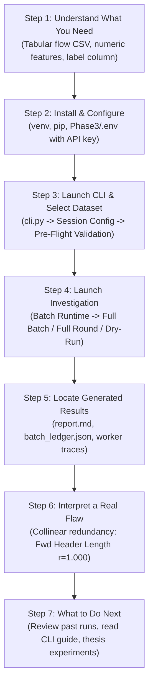
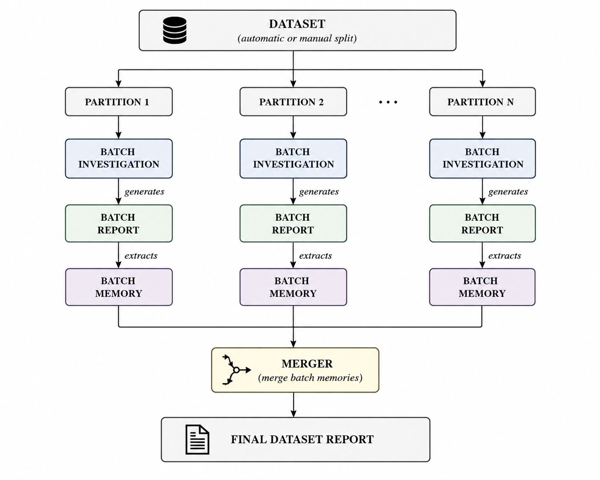
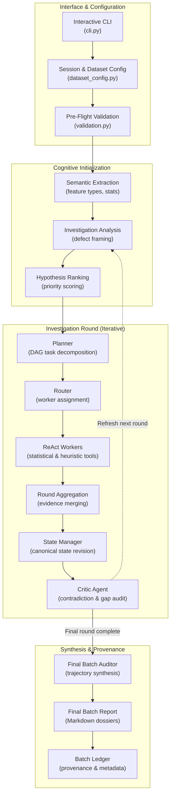
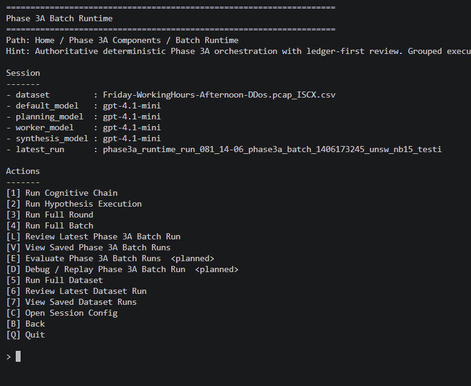
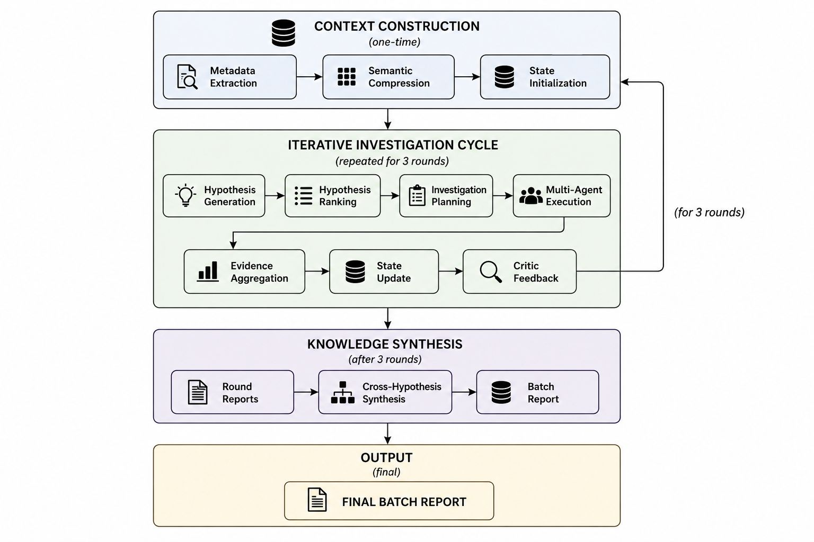
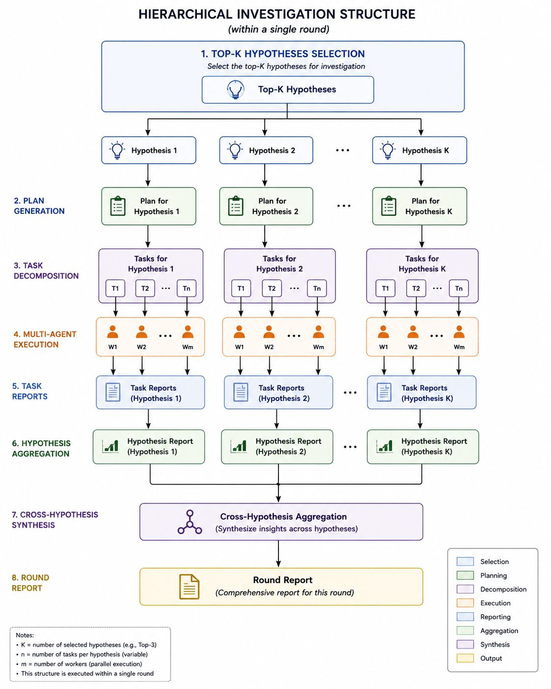
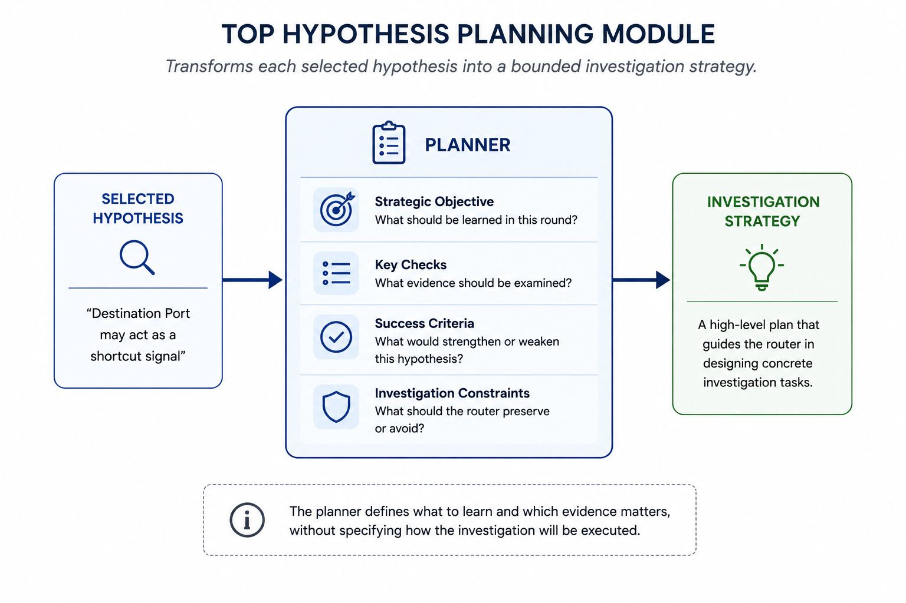
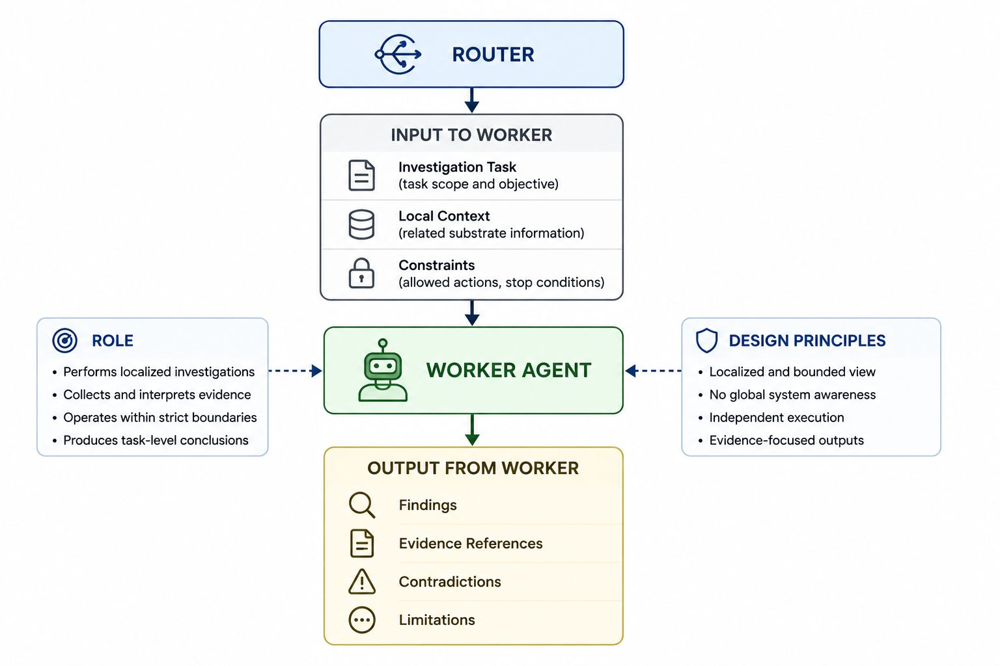
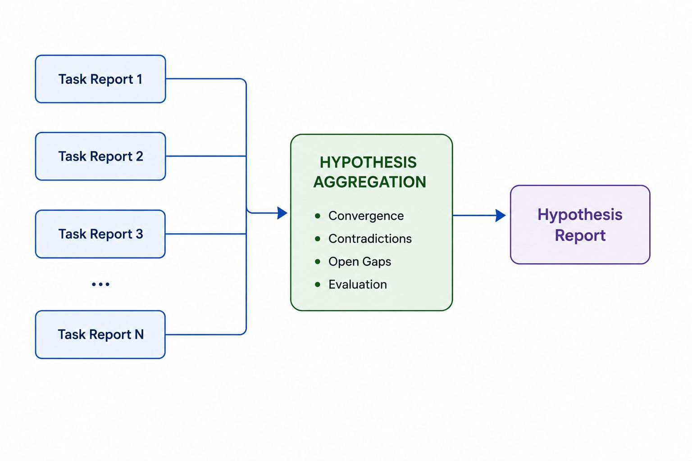

# ATLAS: Agent-Based Dataset Auditing Framework for Network Intrusion Detection

[](https://www.python.org/)
[](https://creativecommons.org/licenses/by-nc-nd/4.0/)

ATLAS is an autonomous multi-agent research framework designed to systematically audit Network Intrusion Detection System (NIDS) datasets for subtle **design artefacts**—such as **shortcut learning opportunities**, **feature redundancy**, **data duplication**, and **distributional anomalies**—that compromise classifier evaluation.

Developed as a Bachelor's Thesis at the *Universitat Politècnica de Catalunya (UPC)*, ATLAS provides an interactive terminal research console and batch execution engine that explores tabular network traffic data, formulates testable hypotheses, executes targeted statistical investigations via ReAct worker agents, and synthesizes multi-round audit reports with complete evidential provenance.

> [!NOTE]
> **Primary Interface & Orchestration:** ATLAS is designed to be used through its interactive terminal interface ([`Phase3/interface/cli.py`](Phase3/interface/cli.py)). The interface orchestrates the underlying modules and provides the primary workflow for dataset selection, pre-flight schema validation, multi-round investigation execution, run inspection, and report navigation. Individual underlying modules can also be invoked programmatically for development, testing, or specialized headless batch workflows.

---

## Table of Contents

- [ATLAS: Agent-Based Dataset Auditing Framework for Network Intrusion Detection](#atlas-agent-based-dataset-auditing-framework-for-network-intrusion-detection)
  - [Table of Contents](#table-of-contents)
  - [1. Project Overview](#1-project-overview)
    - [The Problem](#the-problem)
    - [What an ATLAS Investigation Does](#what-an-atlas-investigation-does)
    - [Current Scope \& Capabilities](#current-scope--capabilities)
  - [2. Primary Interface and Supported Entry Points](#2-primary-interface-and-supported-entry-points)
    - [2.1 The Interactive CLI as Orchestrator](#21-the-interactive-cli-as-orchestrator)
    - [2.2 Comparison of Supported Entry Points](#22-comparison-of-supported-entry-points)
    - [2.3 Prerequisites \& Installation](#23-prerequisites--installation)
    - [2.4 Environment Configuration](#24-environment-configuration)
    - [2.5 Launching the Interface](#25-launching-the-interface)
  - [3. First Investigation: Step-by-Step Tutorial](#3-first-investigation-step-by-step-tutorial)
    - [Step 1 — Understand What You Need](#step-1--understand-what-you-need)
    - [Step 2 — Install and Configure](#step-2--install-and-configure)
    - [Step 3 — Launch the CLI and Select a Dataset](#step-3--launch-the-cli-and-select-a-dataset)
    - [Step 4 — Run Your First Investigation](#step-4--run-your-first-investigation)
      - [What Happens During Execution](#what-happens-during-execution)
    - [Step 5 — Locate the Generated Results](#step-5--locate-the-generated-results)
    - [Step 6 — Interpret a Real Dataset-Quality Finding](#step-6--interpret-a-real-dataset-quality-finding)
      - [Finding Overview: Collinear Redundancy in Flow Headers](#finding-overview-collinear-redundancy-in-flow-headers)
      - [Quantitative Evidence Extracted by ATLAS Workers](#quantitative-evidence-extracted-by-atlas-workers)
      - [Why This is a Dataset Flaw (Literature Provenance)](#why-this-is-a-dataset-flaw-literature-provenance)
      - [Downstream Modelling Implications](#downstream-modelling-implications)
      - [How a Researcher Should Remediate This](#how-a-researcher-should-remediate-this)
      - [Where to Verify in Historical Logs](#where-to-verify-in-historical-logs)
    - [Step 7 — What to Do Next](#step-7--what-to-do-next)
  - [4. Interactive Guide ("How to Use ATLAS")](#4-interactive-guide-how-to-use-atlas)
  - [5. How ATLAS Works: Architecture \& Internal Mechanisms](#5-how-atlas-works-architecture--internal-mechanisms)
    - [5.1 High-Level Architecture](#51-high-level-architecture)
    - [5.2 Component Responsibilities](#52-component-responsibilities)
    - [5.3 Execution Modalities](#53-execution-modalities)
    - [5.4 Batch Investigation Lifecycle](#54-batch-investigation-lifecycle)
    - [5.5 Round-Level Investigation Flow](#55-round-level-investigation-flow)
    - [5.6 Hypothesis Planning \& Task Decomposition](#56-hypothesis-planning--task-decomposition)
    - [5.7 Worker Architecture \& ReAct Execution Loop](#57-worker-architecture--react-execution-loop)
      - [The Worker ReAct Cycle](#the-worker-react-cycle)
      - [Analytical Tools Registry](#analytical-tools-registry)
    - [5.8 Evidence Aggregation, Contradictions \& State Management](#58-evidence-aggregation-contradictions--state-management)
  - [6. Thesis Experiments and Evaluation](#6-thesis-experiments-and-evaluation)
    - [6.1 Research Questions \& Scope](#61-research-questions--scope)
    - [6.2 Historical Corpus Disclosure](#62-historical-corpus-disclosure)
    - [6.3 Scientific Reproduction Pipeline](#63-scientific-reproduction-pipeline)
    - [6.4 Outputs \& Finding Taxonomies](#64-outputs--finding-taxonomies)
  - [7. Advanced Configuration and Technical Reference](#7-advanced-configuration-and-technical-reference)
    - [7.1 Environment Variables \& Runtime Flags](#71-environment-variables--runtime-flags)
    - [7.2 Custom Dataset Integration](#72-custom-dataset-integration)
  - [8. Repository Structure](#8-repository-structure)
  - [9. Software Testing \& Quality Assurance](#9-software-testing--quality-assurance)
  - [10. Limitations and Future Work](#10-limitations-and-future-work)
    - [Documented Limitations](#documented-limitations)
    - [Prioritized Future Work](#prioritized-future-work)
  - [11. License and Citation](#11-license-and-citation)
    - [License](#license)
    - [Citation](#citation)

---

## 1. Project Overview

### The Problem

Modern machine learning-based NIDS models frequently report near-perfect detection scores (99%+ accuracy) on academic benchmark datasets such as **CICIDS2017** and **UNSW-NB15**, yet fail when deployed in live operational networks. A primary cause is **shortcut learning**: classifiers unintentionally learn non-generalizable design artefacts introduced during data collection, flow capture, synthetic attack generation, or feature engineering (e.g., rigid port allocations, identical TCP header flags, or near-constant features) rather than intrinsic malicious behaviors.

### What an ATLAS Investigation Does

ATLAS systematically interrogates a tabular dataset partition through an iterative, hypothesis-driven auditing process:

1. **Extracts Structural Metadata**: Analyzes feature statistics, cardinalities, missingness, and cross-feature correlations without prior manual scripting.
2. **Generates and Ranks Hypotheses**: Formulates testable propositions regarding potential dataset defects (e.g., feature leakage, collinear redundancy, or label-conditioned shortcuts).
3. **Executes Bounded Investigations**: Specialized worker agents use reasoning and analytical tools (ReAct loop) to test specific features against ground-truth labels.
4. **Aggregates and Challenges Findings**: Cross-checks findings across hypotheses, tracks contradictions, and submits results to an independent critic agent.
5. **Synthesizes Comprehensive Reports**: Produces consolidated audit reports containing severity ratings, flaw categorizations, and complete ledger provenance.

### Current Scope & Capabilities

- **Data Modality**: Supervised tabular flow datasets (`.csv`, `.tsv`, `.tab`) containing numeric features and a ground-truth label column.
- **Benchmarks**: Out-of-the-box configuration and partition discovery for **CICIDS2017** and **UNSW-NB15**, alongside arbitrary user-specified custom CSV/TSV datasets.
- **Analytical Tools**: 9 specialized tools covering correlation, Gini impurity, Kolmogorov-Smirnov distribution testing, Wasserstein distance, neighborhood consistency, shortcut analysis, mutual information, duplicate detection, and value distributions.
- **Epistemic Modality**: Evidence-based auditing. ATLAS reports statistical and structural anomalies to assist human researchers; it does not replace human domain expertise or make unverified claims of automated dataset correction.

---

## 2. Primary Interface and Supported Entry Points

### 2.1 The Interactive CLI as Orchestrator

The interactive terminal research console located at [`Phase3/interface/cli.py`](Phase3/interface/cli.py) is the **primary user interface and orchestration layer** for ATLAS.

```
====================================================================
  ATLAS -- Agent-Based Dataset Auditing Framework
====================================================================
  Path: Home / Welcome
  Hint: Choose a path or press [1] to enter the research console.

  [1] Enter ATLAS (Research Console)
  [2] Explore ATLAS (The Conceptual Journey)
  [3] How to Use ATLAS (Operational & Reference Guide)
  [4] Thesis Experiments (Historical Results & Evaluation)

  [0] Quit
====================================================================
```

While underlying Python modules implement specific data processing, statistical analysis, and agent execution tasks, researchers interact with ATLAS primarily through the terminal interface. The CLI coordinates:
- **Session State & Target Configuration**: Selecting predefined benchmark partitions or custom CSV/TSV datasets, configuring LLM models, and adjusting worker step budgets.
- **Bounded Pre-Flight Schema Validation**: Inspecting files non-destructively, inferring column structures, and interactively resolving ambiguous labels or baseline benign classes before launching expensive LLM runs.
- **Execution Mode Orchestration**: Launching full multi-round batch investigations, single-round exploratory audits, or lightweight cognitive dry-runs.
- **Interactive Observability & Run Review**: Inspecting live terminal event streams, browsing historical runs, reviewing worker ReAct reasoning chains, and reading generated Markdown audit reports directly inside the terminal.

### 2.2 Comparison of Supported Entry Points

ATLAS provides distinct entry points tailored to different workflows:

| Entry Point | Command / Module | Primary Purpose & Intended User Experience |
| :--- | :--- | :--- |
| **Interactive Terminal Console** *(Recommended)* | `python Phase3/interface/cli.py` | **Primary user interface.** Complete interactive workflow: dataset selection, schema disambiguation, pre-flight checks, batch orchestration, run review, and report navigation. |
| **Direct Batch Runtime** *(Headless Execution)* | `python Phase3/main.py`<br>or `run_phase3a_batch()` | **Headless / Programmatic execution.** Directly executes multi-round batch investigations using environment variables (`NIDS_DATASET_PATH`, `OPENAI_MODEL`). Designed for cluster scripts, unattended batch jobs, and automated pipelines. *(Note: Runs the full pipeline but bypasses interactive menus and terminal report browsing).* |
| **Scientific Reproduction Scripts** | `python evaluation/scripts/...` | **Historical analysis & reproducibility.** Read-only scripts (`validate_corpus.py`, `extract_metrics.py`, `aggregate_metrics.py`, `extract_findings.py`) that parse archived run artifacts in `Phase3/logs/` to reproduce thesis evaluation tables and metrics without LLM API calls. |
| **Automated Software Test Suite** | `pytest tests/`<br>`pytest Phase3/tests/` | **Software quality assurance.** 240+ unit and integration tests verifying component contracts, state transitions, custom dataset schema inference, and orchestration logic using local mocks. Zero LLM API calls. |

### 2.3 Prerequisites & Installation

- **Python**: Version 3.10 or higher (tested with Python 3.11 and 3.13).
- **LLM Access**: An OpenAI API key with access to `gpt-4.1-mini` (or equivalent model).
- **Operating System**: Linux, macOS, or Windows.

Clone the repository, create a virtual environment, and install dependencies:

```bash
# Clone the repository
git clone https://github.com/your-username/nids-smell-audit.git
cd nids-smell-audit

# Create and activate virtual environment
# Linux / macOS:
python3 -m venv .venv
source .venv/bin/activate

# Windows (PowerShell):
python -m venv .venv
.venv\Scripts\Activate.ps1

# Install required dependencies
pip install -r Phase3/requirements.txt
```

### 2.4 Environment Configuration

Configure your OpenAI API credentials:

```bash
# Copy template environment file
cp Phase3/.env.example Phase3/.env
```

Edit `Phase3/.env` (or set environment variables in your shell):

```ini
OPENAI_API_KEY=sk-...
OPENAI_MODEL=gpt-4.1-mini
OPENAI_TEMPERATURE=0.0
```

### 2.5 Launching the Interface

Launch the interactive console directly from the repository root:

```bash
# Launch interactive welcome screen (recommended for first-time users)
python Phase3/interface/cli.py

# Or launch directly into the Research Console (skipping welcome)
python Phase3/interface/cli.py --skip-welcome

# Non-interactive CLI presentation flags
python Phase3/interface/cli.py --version   # Display version and descriptor
python Phase3/interface/cli.py --usage     # Display operational usage summary
python Phase3/interface/cli.py --concept   # Read the conceptual explorer analogy
```

---

## 3. First Investigation: Step-by-Step Tutorial

This step-by-step tutorial guides a first-time user through running their first ATLAS audit, locating generated artifacts, and interpreting a concrete, evidence-backed dataset-quality defect.



### Step 1 — Understand What You Need

Before launching an audit, ensure you understand the target problem and data prerequisites:

1. **What ATLAS Discovers**: ATLAS does not simply calculate top-level model accuracy. It systematically detects **design artefacts**—such as **shortcut learning opportunities** (features that unnaturally correlate with labels due to collection setup), **collinear redundancy** (duplicated or algebraically equivalent features), **data duplication** (identical flow rows across attack classes), and **distributional anomalies** (extreme skewness or near-constant features) that allow machine learning classifiers to score high on test benchmarks while failing on live networks.
2. **Accepted Dataset Format**: ATLAS accepts supervised tabular network flow captures in `.csv`, `.tsv`, or `.tab` formats with a header row.
3. **Why Numeric Features Are Required**: ATLAS analytical tools (such as Pearson/Spearman correlation, Kolmogorov-Smirnov distance, Wasserstein metric, Gini impurity, and variance profiling) compute statistical moments and distributions over numeric feature vectors. Categorical features can be pre-encoded or evaluated via cardinality tools.
4. **Why a Ground-Truth Label Column Is Required**: To evaluate class separation, feature leakage, and class-conditioned distributional divergence, ATLAS needs to know which flows belong to benign baseline traffic versus attack traffic.
5. **What the Benign Baseline Represents**: The benign class (e.g., `BENIGN`, `0`, or `normal`) serves as the operational baseline. ATLAS contrasts attack traffic against this baseline to evaluate whether observed feature behaviors represent genuine attack signatures or synthetic testbed artifacts (such as fixed source IP subnets or rigid destination port allocations).

### Step 2 — Install and Configure

Ensure your environment is set up and your OpenAI API key is configured as described in [Section 2.3](#23-prerequisites--installation) and [Section 2.4](#24-environment-configuration):

```bash
# Verify Python version (3.10+)
python --version

# Verify dependencies are installed
python -c "import pandas, openai, pydantic; print('Dependencies verified.')"

# Verify Phase3/.env exists with your OpenAI key
# OPENAI_API_KEY=sk-...
```

### Step 3 — Launch the CLI and Select a Dataset

Launch the interactive console from the repository root:

```bash
python Phase3/interface/cli.py
```

1. **Enter the Research Console**: On the Welcome Screen, press `[1]` to enter the main menu.
2. **Open Session Configuration**: From the main menu, press `[3]` for **Session Configuration**.
3. **Select Dataset Source**: Press `[1]` to **Change Active Dataset/Partition**. You can select from three options:
   - **[1] Predefined Benchmark Partitions**: Standard partitions from CICIDS2017 (e.g., `Friday-WorkingHours-Morning.pcap_ISCX.csv`) and UNSW-NB15.
   - **[2] Discovered Files in Project Data Directory**: Any CSV/TSV file residing in `Phase3/data/`.
   - **[3] Custom Filesystem Path**: Enter an absolute or relative path to any external CSV/TSV file (handles surrounding quotes and spaces automatically).
4. **Review Pre-Flight Schema Validation**:
   When a partition is selected, ATLAS runs a bounded, non-destructive schema inspection (`inspect_custom_dataset_preflight`). It samples rows and checks headers without reading multi-gigabyte files into memory:
   - **Label Column**: Automatically detected if named `Label`, `class`, or `attack`. If ambiguous, an interactive selection menu lists candidate columns for you to choose.
   - **Benign Baseline**: Inferred automatically (`BENIGN`, `0`, `normal`). If ambiguous, an interactive menu allows you to select the benign class.
   - **Confirmation Screen**: Displays the resolved path, file size, sampled rows, numeric feature count, confirmed label column, and confirmed benign value. Press `[1]` to confirm and set as active dataset.
5. Press `[B]` to return to the Main Menu.

### Step 4 — Run Your First Investigation

From the Research Console Main Menu, press `[1]` to enter **ATLAS Batch Runtime**. Choose an execution scope:

- **[1] Full Batch Investigation (Recommended)**:
  - Executes a complete 3-round autonomous investigation.
  - Across 3 rounds, ATLAS plans 9 hypotheses, decomposes them into 27–30 worker tasks, dispatches ReAct worker agents with analytical tools, reconciles findings in the state store, performs Critic agent reviews, and synthesizes a final partition audit report.
  - **Runtime & Cost**: Typically takes ~15 minutes and invokes LLM API calls across worker reasoning steps.
- **[2] Full Round Investigation**:
  - Executes a single complete round (3 hypotheses, 9 worker tasks, aggregation, and a single-round report). Takes ~5 minutes.
- **[3] Cognitive-Only Pipeline (Fast Dry-Run)**:
  - Executes semantic metadata extraction, defect framing, and initial hypothesis priority ranking **without** dispatching worker tool loops or invoking worker LLMs.
  - **Runtime & Cost**: Takes ~30–60 seconds and incurs minimal LLM API usage. Excellent for testing API credentials and verifying dataset schema compatibility.

#### What Happens During Execution
While running, ATLAS streams real-time console messages:
1. **Planning**: Decomposes qualitative hypotheses into concrete analytical task DAGs.
2. **Worker Execution (ReAct Loop)**: Worker agents formulate thoughts, invoke deterministic statistical tools on the dataset partition (e.g., computing Kolmogorov-Smirnov statistics, correlations, or Gini impurity), observe quantitative outputs, and synthesize structured findings.
3. **Aggregation & State Commits**: Merges worker findings, highlights contradictions, and advances canonical batch state ($v_1 \to v_4 \to v_7 \to v_{10}$).
4. **Critic Review & Final Synthesis**: Audits the trajectory for analytical gaps and generates the final audit dossier.

### Step 5 — Locate the Generated Results

When the investigation completes, ATLAS presents a post-run summary menu. You can inspect results immediately in the terminal or navigate to persisted disk artifacts:

| Output Artifact | Location on Disk | Description |
| :--- | :--- | :--- |
| **In-Terminal Report Viewer** | CLI post-run prompt (press `[1]`) | Renders formatted markdown audit dossier directly in the terminal console. |
| **Consolidated Final Report** | `Phase3/logs/final_batch_report_runs/<run_id>/report.md` | Complete narrative audit dossier with executive summary, finding breakdown, modelling implications, and open uncertainties. |
| **Round Audit Report** | `Phase3/logs/round_report_runs/<run_id>/report.md` | Scoped single-round report detailing worker findings from that round. |
| **Master Batch Ledger** | `Phase3/logs/phase3a_runtime_runs/<run_id>/batch_ledger.json` | Comprehensive JSON record containing canonical state snapshots ($v_1 \dots v_{10}$), hypothesis trajectories, worker task manifests, and complete provenance. |
| **Worker Execution Traces** | `Phase3/logs/worker_runs/<run_id>/` | Per-worker execution logs containing `tool_events.json` (exact tool inputs/outputs), `worker_result.json`, `prompt.txt`, and `raw_response.txt`. |

### Step 6 — Interpret a Real Dataset-Quality Finding

To understand what ATLAS reports look like in practice, consider this actual finding discovered during historical evaluation of the benchmark file **`CICIDS2017 / Friday-WorkingHours-Morning.pcap_ISCX.csv`** (Run 050 / Run 064):

#### Finding Overview: Collinear Redundancy in Flow Headers
- **Canonical Flaw Family**: *Strong Feature Dependency Pair (Collinear Redundancy)*
- **Affected Features**: `Fwd Header Length` and `Fwd Header Length.1` (also confirmed between `Total Length of Fwd Packets` and `Subflow Fwd Bytes`).
- **Severity & Confidence**: Impact 60/100 (Moderate), Confidence 70/100 (Strong).

#### Quantitative Evidence Extracted by ATLAS Workers
During Round 1, a ReAct worker assigned hypothesis `HYP-002` invoked the `feature_relation` tool:
```json
{
  "tool": "feature_relation",
  "feature_a": "Fwd Header Length",
  "feature_b": "Fwd Header Length.1",
  "metrics": {
    "pearson_correlation": 1.0000,
    "spearman_correlation": 1.0000,
    "residual_variance": 0.0,
    "identical_value_ratio": 1.0000
  }
}
```
The quantitative evidence confirmed that across all 191,033 flows in the partition, the values of `Fwd Header Length` and `Fwd Header Length.1` are 100% identical with zero residual variance.

#### Why This is a Dataset Flaw (Literature Provenance)
This finding is an autonomous recovery of a known defect in the **CICFlowMeter** feature extraction software (catalogued as defect **CIC-03** in published literature by Santos et al., 2021 and Panigrahi & Borah, 2018). Due to an extraction loop bug, CICFlowMeter computed the forward header length twice and appended it as a distinct column.

#### Downstream Modelling Implications
1. **Distorted Feature Importance**: Machine learning algorithms (such as Random Forests or XGBoost) split importance weights across duplicated features, artificially diluting genuine predictive signals.
2. **Collinearity Instability**: Linear classifiers and regularized logistic regression become unstable when encountering exact collinearity ($r = 1.000$).
3. **Shortcut Vulnerability**: Models can inadvertently learn extraction quirks or header padding specific to the capture tool rather than authentic packet dynamics.

#### How a Researcher Should Remediate This
In your data preprocessing pipeline prior to model training:
```python
# Drop redundant duplicate feature discovered by ATLAS
df = df.drop(columns=["Fwd Header Length.1", "Subflow Fwd Bytes"])
```

#### Where to Verify in Historical Logs
You can inspect the exact evidence for this finding in:
- `Phase3/logs/final_batch_report_runs/final_batch_report_run_012_12-06_phase3a_batch_1206183423_friday_workingh/report.md` (Finding 2).
- `Phase3/logs/phase3a_runtime_runs/phase3a_runtime_run_050_11-06_phase3a_batch_1106133035_friday_workingh/batch_ledger.json`.

### Step 7 — What to Do Next

Now that your first investigation is complete:
1. **Browse Past Runs Interactively**: In the CLI Research Console, navigate to **ATLAS Batch Runtime** (`[1]`) -> **Review Past Runs** (`[4]`) to inspect round manifests, worker thoughts, tool calls, and state transitions.
2. **Consult the Built-in Terminal Guide**: Run `python Phase3/interface/cli.py --usage` or choose `[3] How to Use ATLAS` to review component contracts, tool references, and diagnostic recipes.
3. **Explore Thesis Experiments**: Select `[4] Thesis Experiments` on the CLI welcome screen to browse historical benchmark runs, canonical flaw families, and cross-model evaluation findings.

---

## 4. Interactive Guide ("How to Use ATLAS")

ATLAS includes a comprehensive, built-in operational guide directly inside the terminal interface. It is accessible from the welcome screen by selecting **[3] How to Use ATLAS**, or via the command line with:

```bash
python Phase3/interface/cli.py --usage
```

The in-terminal guide uses progressive disclosure across 7 dedicated sections:

| Section | Focus |
| :--- | :--- |
| **[1] Getting Started with ATLAS** | Problem motivation, auditing objectives, and the epistemic distinction between hypotheses, evidence, and findings. |
| **[2] Ways to Run ATLAS** | Execution scopes (Component, Cognitive Chain, Full Round, Full Batch, Dataset Runtime) with real CLI navigation paths. |
| **[3] General Investigation Flow** | Step-by-step dataflow walkthrough across all 7 investigation stages. |
| **[4] Components (What Each Does)** | Comprehensive catalogue of all 12 Phase 3A/3B components (roles, inputs, outputs, contracts). |
| **[5] Tools (Agent Analytical Capabilities)** | Full reference of all 9 analytical tools, metric bounds, and interpretation guidelines. |
| **[6] Debugging and Observability** | Systematic run inspection, 12-stage component diagnostics, and 14 troubleshooting recipes by failure type. |
| **[7] Reports and Persisted Outputs** | Structure and interpretation of Round Reports, Final Batch Reports, and master ledgers. |

*(Refer to the in-terminal guide for complete component and tool reference documentation.)*

---

## 5. How ATLAS Works: Architecture & Internal Mechanisms

ATLAS employs a **layered micro-architecture** that strictly decouples epistemic planning from empirical tool execution.

### 5.1 High-Level Architecture

The relationship between the tabular dataset partition, the multi-agent cognitive stack, the deterministic tool registry, and the LLM backend is depicted below:

<p align="center">
  
</p>

*Figure 1: High-level architecture showing the relationship between components, datasets, tool registry, and LLM backend.*

### 5.2 Component Responsibilities



| Component | Module Path | Primary Responsibility |
| :--- | :--- | :--- |
| **CLI & UI** | `Phase3/interface/` | Terminal menus, session configuration, run inspection, and report rendering. |
| **Dataset Runtime** | `Phase3/data/` | CSV/TSV loading, schema inspection, pre-flight validation, and attack mask generation. |
| **Semantic Extraction** | `Phase3/semantic_extraction/` | Extracts feature statistics, cardinalities, missingness, and pairwise correlations. |
| **Investigation Analysis** | `Phase3/investigation_analysis/` | Interprets metadata to formulate testable artefact hypotheses. |
| **Hypothesis Ranking** | `Phase3/hypothesis_ranking/` | Scores and ranks hypotheses by expected impact, confidence, and novelty. |
| **Planner** | `Phase3/planner/` | Decomposes hypotheses into targeted directed acyclic graphs (DAGs) of tasks. |
| **Router** | `Phase3/router/` | Assigns tasks to worker execution configurations. |
| **Worker Agents** | `Phase3/worker/` | Executes ReAct reasoning loops invoking statistical tools on dataset partitions. |
| **Tools Registry** | `Phase3/tools/` | Analytical routines (correlation, KS-test, Wasserstein, Gini, shortcut analysis). |
| **Aggregation** | `Phase3/aggregation/` | Merges findings, identifies contradictions, and consolidates round evidence. |
| **State Manager** | `Phase3/state_manager/` | Maintains the authoritative canonical state and tracks version history ($v_1 \to v_{10}$). |
| **Critic** | `Phase3/critic/` | Reviews findings for evidential support, missing tests, and consistency. |
| **Final Batch Auditor** | `Phase3/final_batch_auditor/` | Synthesizes multi-round trajectories into a consolidated audit dossier. |
| **Batch Orchestrator** | `Phase3/phase3_runtime/` | Manages round lifecycles, event streams, worker concurrency, and `BatchLedger` persistence. |

### 5.3 Execution Modalities

The framework supports two primary operational execution modes:

<p align="center">
  
</p>

*Figure 2: Execution modalities supported by the framework (Single-Round vs Multi-Round Batch Mode).*

- **Single Round Mode (`[2] Full Round` in CLI or programmatic single-round invocation)**: A self-contained, single-round pass designed for fast exploratory checks, baseline verification, or component testing over a single partition.
- **Multi-Round Batch Mode (`[1] Full Batch` in CLI or `main_phase3a_batch` in `Phase3/main.py`)**: The authoritative multi-round auditing pipeline. Executes multiple coordinated investigation rounds with state persistence, hypothesis re-ranking, cross-finding aggregation, critic review, and consolidated trajectory auditing.

### 5.4 Batch Investigation Lifecycle

An end-to-end batch investigation progresses through distinct initialization, iterative investigation, and final synthesis stages:

<p align="center">
  
</p>

*Figure 3: Full batch execution lifecycle spanning initialization, iterative investigation rounds, and final synthesis.*

1. **Dataset Selection & Ingestion**: Loads the tabular partition into memory and initializes `CanonicalBatchState` ($v_1$).
2. **Semantic Extraction & Framing**: Generates initial feature profiles, correlation matrices, and preliminary defect hypotheses.
3. **Iterative Investigation Rounds (Rounds 1–3)**: Iteratively explores high-priority and exploratory hypotheses, accumulating evidence in state versions ($v_1 \to v_4 \to v_7 \to v_{10}$).
4. **Trajectory Synthesis**: The `FinalBatchAuditor` analyzes the complete state trajectory, checks surviving contradictions, and generates the final audit report.

### 5.5 Round-Level Investigation Flow

Within each individual investigation round, ATLAS coordinates planning, execution, aggregation, and critique:

<p align="center">
  
</p>

*Figure 4: Detailed dataflow within a single investigation round.*

- **State Snapshot**: Freezes current canonical state to guarantee deterministic context across parallel workers.
- **Hypothesis Selection**: Selects 3 active hypotheses (2 prioritized by accrued evidence + 1 dedicated exploratory hypothesis to prevent local search entrapment).
- **Task Planning & Routing**: Decomposes selected hypotheses into 3 worker tasks each (9 total tasks per round).
- **Intra-Hypothesis Aggregation**: Reconciles findings from assigned workers and isolates emergent contradictions.
- **State Transition**: State Manager commits evidence deltas and advances state version ($v_t \to v_{t+1}$).
- **Critic Evaluation**: Independent critic reviews round trajectory and highlights open analytical pressures.

### 5.6 Hypothesis Planning & Task Decomposition

The Planner decomposes high-level qualitative hypotheses about dataset flaws into directed acyclic graphs (DAGs) of concrete statistical tasks:

<p align="center">
  
</p>

*Figure 5: Hypothesis decomposition into a structured investigation task plan.*

Each hypothesis is resolved into actionable leaf tasks:
- *"Calculate Gini impurity of `Destination Port` across attack vs. benign flows."*
- *"Compute Kolmogorov-Smirnov distance between `Flow Duration` distributions."*
- *"Identify exact duplicate row patterns across attack partitions."*

### 5.7 Worker Architecture & ReAct Execution Loop

Individual tasks are executed by specialized worker agents operating in a bounded **ReAct (Reasoning + Acting)** loop:

<p align="center">
  
</p>

*Figure 6: Worker agent internal architecture and ReAct execution loop.*

#### The Worker ReAct Cycle
1. **Thought**: LLM evaluates the assigned hypothesis, task constraints, and current evidence.
2. **Action**: Dispatches a registered analytical tool with explicit feature arguments.
3. **Execution**: The deterministic statistical tool executes over the Pandas partition.
4. **Observation**: Returns quantitative evidence blocks (p-values, correlations, entropy).
5. **Synthesis**: Emits a structured finding with explicit claim, evidence refs, severity rating, and confidence score.

#### Analytical Tools Registry

| Tool | Module | Purpose |
| :--- | :--- | :--- |
| `feature_summary` | `tools/feature_summary.py` | Descriptive statistics, non-zero ratios, cardinalities, missingness. |
| `distribution_analysis` | `tools/distribution_analysis.py` | Quartiles, skewness, kurtosis, class-conditioned distribution comparisons. |
| `cardinality_analysis` | `tools/cardinality_analysis.py` | Unique value ratios, detecting constant features and singletons. |
| `feature_relation` | `tools/feature_relation.py` | Pearson and Spearman correlation, collinear dependency pairs. |
| `duplication_analysis` | `tools/duplication_analysis.py` | Exact and near-duplicate row measurements across attack classes. |
| `gini_analysis` | `tools/gini_analysis.py` | Gini impurity and single-feature class separation power. |
| `ks_analysis` | `tools/ks_analysis.py` | Kolmogorov-Smirnov two-sample distribution distance testing. |
| `wasserstein_distance` | `tools/wasserstein_distance.py` | Earth Mover's Distance between benign and attack distributions. |
| `shortcut_analysis` | `tools/shortcut_analysis.py` | Decision stump classification to detect single-feature leakage shortcuts. |

### 5.8 Evidence Aggregation, Contradictions & State Management

After workers complete their investigations, findings are reconciled into canonical batch memory:

<p align="center">
  
</p>

*Figure 7: Evidence aggregation, contradiction detection, and canonical state management pipeline.*

- **Intra-Hypothesis Aggregation**: Merges findings across parallel workers, checking whether findings reinforce or contradict each other.
- **Contradiction Preservation**: Unlike heuristic systems that average away contradictory results, ATLAS explicitly records unresolved tensions (e.g., a feature appearing separative in one sub-regime but invariant globally).
- **Canonical State Store**: `state/store.py` applies immutable, append-only delta updates to `CanonicalBatchState`, preserving full provenance for every audited finding.

---

## 6. Thesis Experiments and Evaluation

ATLAS was evaluated across benchmark intrusion detection datasets as part of the bachelor's thesis research at UPC. The results, metrics, figures, and reproduction scripts can be navigated interactively from the welcome screen by selecting **[4] Thesis Experiments**.

### 6.1 Research Questions & Scope

The evaluation addressed three central research questions:
- **RQ1 (Literature Artefact Recovery)**: Can ATLAS autonomously recover known design artefacts documented in published NIDS literature without prior hand-coded rules?
- **RQ2 (Autonomous Investigation Capability)**: Does multi-agent orchestration sustain analytical diversity, hypothesis refinement, and stable state progression across multiple rounds?
- **RQ3 (Generalization Capability)**: Do the investigation mechanisms generalize across diverse attack partitions and independent dataset architectures (CICIDS2017 vs. UNSW-NB15)?

### 6.2 Historical Corpus Disclosure

- **Corpus Runs**: The evaluation corpus consists of runs conducted across 10 distinct traffic partitions:
  - *CICIDS2017 (8 partitions)*: Monday (Benign), Tuesday (Brute Force), Wednesday (DoS), Thursday-WebAttacks, Thursday-Infiltration, Friday-Morning, Friday-DDoS, and Friday-PortScan.
  - *UNSW-NB15 (2 partitions)*: Official Training and Testing partitions.
- **The 14 vs. 15 Run Corpus**: 
  - `validate_corpus.py` checks 14 base runs establishing initial partition coverage.
  - `extract_metrics.py` processes 15 runs, incorporating Run 082 (`Friday-PortScan` replication) to enable multi-run consistency and stability analysis on PortScan traffic. Both inventories are legitimate and verified.
- **Batch Finalization Note**: In 6 historical runs (runs 071, 072, 073, 074, 076, 081), batch ledgers recorded a final status of `failed` due to a strict character-length validation rule in the presentation generator (`final_batch_auditor`). All 3 investigation rounds, 27–30 worker tasks, and 10 state transitions ($v_1 \to v_{10}$) completed successfully and their intermediate evidence is fully preserved.

### 6.3 Scientific Reproduction Pipeline

The evaluation pipeline scripts in [`evaluation/scripts/`](evaluation/scripts/) operate with read-only access on stored runtime artifacts:

```bash
# Step 1: Validate artifact completeness across evaluation runs
python evaluation/scripts/validate_corpus.py

# Step 2: Extract 12 quantitative behavioral metrics per run (entropy, revisit rate, stability)
python evaluation/scripts/extract_metrics.py

# Step 3: Aggregate metrics by dataset and partition
python evaluation/scripts/aggregate_metrics.py

# Step 4: Extract and classify findings into canonical flaw families
python evaluation/scripts/extract_findings.py
```

### 6.4 Outputs & Finding Taxonomies

Reproduction outputs are persisted in JSON, CSV, and Markdown under [`evaluation/outputs/`](evaluation/outputs/) and [`evaluation/findings/`](evaluation/findings/):
- `run_metrics_corrected.json` / `csv`: Per-run quantitative metrics (Tool Diversity $H \approx 1.83$, Feature Revisit Rate $R \approx 85.9\%$, State Churn $= 3.333$).
- `canonical_findings.json`: 13 canonical flaw families (including *Constant Zero-Variance Features*, *Strong Feature Dependency Pairs*, *Packet Length Structural Variation*, *Destination Port Concentration*).
- `semantic_families.json`: 7 high-level defect categories (Feature Engineering Redundancy, Shortcut Learning Signals, Distributional Artifacts, Temporal Artifacts, Label Structure Issues, Data Quality Issues, Genuine Behavioral Signals).

---

## 7. Advanced Configuration and Technical Reference

### 7.1 Environment Variables & Runtime Flags

Advanced execution parameters can be configured via shell environment variables or inside `Phase3/.env`:

| Variable | Default | Purpose |
| :--- | :--- | :--- |
| `OPENAI_API_KEY` | *(required)* | OpenAI authentication key. |
| `OPENAI_MODEL` | `gpt-4.1-mini` | Default LLM model assigned across pipeline components. |
| `OPENAI_TEMPERATURE` | `0.0` | Sampling temperature for reproducible outputs. |
| `OPENAI_SEED` | *(none)* | Deterministic random seed for LLM sampling. |
| `NIDS_DATASET_PATH` | *(auto-discovered)* | Explicit path override to a dataset partition CSV/TSV. |
| `NIDS_MAX_STEPS` | `10` | Maximum allowable ReAct tool steps per worker task. |
| `PHASE3A_MAX_ROUNDS` | `3` | Maximum number of iterative investigation rounds. |
| `PHASE3A_EXECUTION_MODE` | `full_batch` | Runtime mode: `full_batch`, `full_round`, or `dry_run`. |
| `PHASE3A_ENABLE_CRITIC` | `1` | Enables or disables independent Critic agent reviews (`1` or `0`). |

### 7.2 Custom Dataset Integration

ATLAS supports auditing arbitrary network flow datasets. The framework automatically parses headers, infers candidate label columns, and creates a lightweight `DatasetConfig` mapping:

1. **Format**: Delimited CSV or TSV files with a header row.
2. **Numeric Features**: All integer and floating-point columns are indexed as potential audit targets.
3. **Labels**: Binary or multiclass ground truth. If standard names (`Label`, `class`, `attack`) are not present, ATLAS triggers interactive disambiguation.
4. **Pre-Flight Inspection**: Non-destructive sampling inspects row count, memory footprint, and column types without reading multi-gigabyte files into memory.

---

## 8. Repository Structure

```
nids-smell-audit/
├── Phase3/                                 # Primary runtime & application source
│   ├── interface/                         # Interactive CLI, terminal UI & guides
│   │   ├── cli.py                         # Main interactive CLI entry point
│   │   ├── terminal_ui.py                 # Terminal screen rendering & styling
│   │   ├── welcome.py                     # Welcome screen & concept narratives
│   │   └── thesis_experiments.py          # Thesis evaluation browser & catalogues
│   ├── data/                              # Dataset loading, config & validation
│   │   ├── dataset_config.py              # Benchmark & custom DatasetConfig contracts
│   │   ├── loader.py                      # Tabular CSV/TSV loader & cleaner
│   │   └── validation.py                  # Pre-flight schema validation & attack masks
│   ├── phase3_runtime/                    # Multi-round batch orchestrator & ledger
│   │   ├── orchestrator.py                # Core run_phase3a_batch engine
│   │   ├── round_executor.py              # Single round orchestration
│   │   └── ledger.py                      # BatchLedger & provenance tracking
│   ├── semantic_extraction/               # Metadata extraction agent
│   ├── investigation_analysis/            # Defect hypothesis formulation
│   ├── hypothesis_ranking/                # Priority ranking
│   ├── planner/                           # DAG task decomposition
│   ├── router/                            # Task routing
│   ├── worker/                            # ReAct worker execution engine
│   ├── tools/                             # 9 analytical statistical tools
│   ├── aggregation/                       # Finding aggregation & contradictions
│   ├── state_manager/                     # Authoritative canonical state management
│   ├── critic/                            # Critic evaluation agent
│   ├── final_batch_auditor/               # Trajectory synthesis auditor
│   ├── final_batch_report/                # Markdown audit dossier generator
│   ├── main.py                            # Batch runtime entry point
│   ├── config.py                          # Global runtime paths and defaults
│   ├── requirements.txt                   # Pinned Python dependencies
│   ├── .env.example                       # Environment configuration template
│   └── tests/                             # Phase 3 component test suite
├── evaluation/                            # Thesis evaluation pipeline & reproduction
│   ├── scripts/                           # Reproducibility scripts (validate, extract, aggregate)
│   ├── outputs/                           # Extracted metrics and validation reports
│   ├── findings/                          # Canonical defect families and taxonomy
│   └── README.md                          # Evaluation pipeline documentation
├── docs/                                  # Reference documentation & figures
│   └── images/                            # Architecture and workflow figures
├── tests/                                 # Root test suite (integration & custom dataset tests)
│   ├── test_custom_dataset_selection.py   # Custom dataset selection & validation suite
│   ├── test_dataset_runtime.py            # Dataset runtime contracts
│   └── ...                                # Observability, state, and CLI test suites
├── pytest.ini                             # Pytest configuration
├── conftest.py                            # Shared test fixtures
└── TFG.pdf                                # Completed Bachelor's Thesis document
```

---

## 9. Software Testing & Quality Assurance

ATLAS maintains comprehensive automated test suites covering component contracts, state transitions, custom dataset parsing, and end-to-end orchestration without invoking live LLM API calls:

```bash
# Run root test suite (248 tests passing, verified)
pytest tests/

# Run the custom dataset selection test suite (16 tests passing, verified)
pytest tests/test_custom_dataset_selection.py -v

# Run Phase 3 component tests
pytest Phase3/tests/
```

*Note: Software regression tests (`pytest`) verify code execution integrity, whereas the scripts in `evaluation/scripts/` reproduce scientific research metrics over historical dataset audit logs.*

---

## 10. Limitations and Future Work

### Documented Limitations

1. **Computational & API Cost**: Full batch investigations involving 3 rounds and up to 27 worker investigations require substantial LLM inference (averaging approximately 15.5 minutes per batch run).
2. **Tabular Flow Feature Focus**: Auditing is currently optimized for tabular CSV flow features. ATLAS does not directly inspect raw PCAP packet payload bytes or wire-level sequences.
3. **Supervised Target Requirement**: Tools and hypothesis generators rely on distinguishing benign baseline traffic from anomalies or attacks. Unlabeled datasets must be assigned a baseline label to be audited.
4. **Finite Evaluation Corpus**: The 15-run experimental campaign demonstrated feasibility and defect discovery, but represents an initial empirical baseline rather than an exhaustive census:
   - *Limited Repetitions*: Friday-Morning has 4 runs, Friday-DDoS has 2, Friday-PortScan has 2, while other partitions have 1 run.
   - *Limited Partition Coverage*: Covers selected traffic slices of CICIDS2017 and UNSW-NB15.
   - *Limited Benchmark Diversity*: Evaluated on two benchmarks; broader cross-dataset generalization remains to be established.

### Prioritized Future Work

In accordance with the thesis research agenda, future work is prioritized as follows:

1. **Increase Repetitions on Existing Partitions**: Conduct multiple independent replications under identical conditions to quantify stochastic variance in hypothesis selection and tool invocation.
2. **Expand Partition Coverage**: Audit broader operational slices, including weekend traffic, multi-day captures, and alternative attack scenarios.
3. **Expand Dataset Diversity**: Evaluate ATLAS on newer independent NIDS benchmarks (e.g., CSE-CIC-IDS2018, TON_IoT).
4. **Strengthen Statistical & Reproducibility Procedures**: Establish formal sample sizes via statistical power analysis, report rigorous confidence intervals, and develop automated dataset repair recommendations.

---

## 11. License and Citation

### License

This project is licensed under the [Creative Commons Attribution-NonCommercial-NoDerivatives 4.0 International License (CC BY-NC-ND 4.0)](https://creativecommons.org/licenses/by-nc-nd/4.0/).

### Citation

If you use ATLAS or refer to its findings in your research, please cite:

```bibtex
@thesis{andreu2025atlas,
  author       = {Andreu, Pol},
  title        = {Auditing NIDS Datasets Using LLM Agents},
  school       = {Universitat Politècnica de Catalunya (UPC)},
  year         = {2025},
  type         = {Bachelor's Thesis}
}
```
