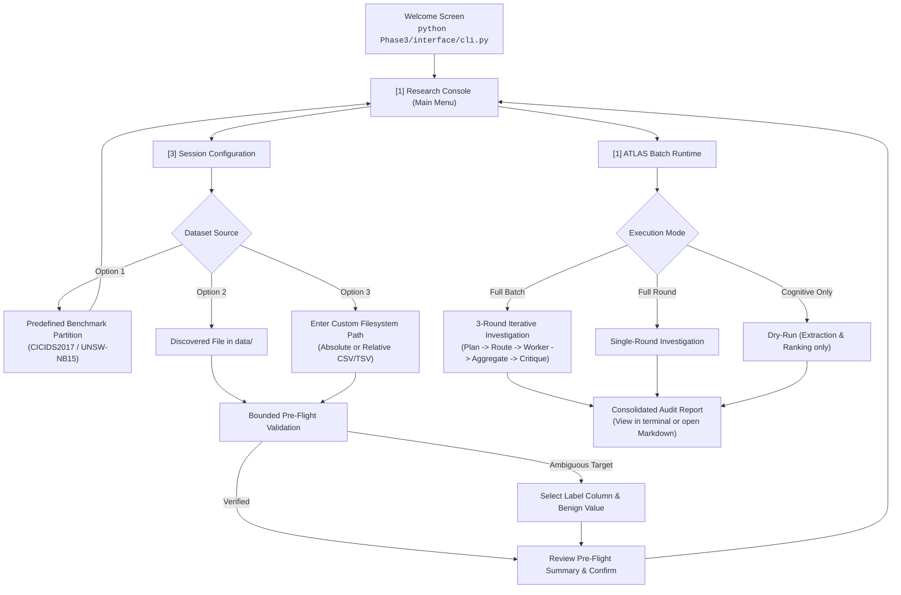
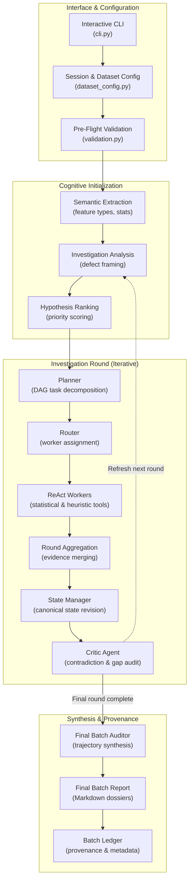

# ATLAS: Agent-Based Dataset Auditing Framework for Network Intrusion Detection

[](https://www.python.org/)
[](https://creativecommons.org/licenses/by-nc-nd/4.0/)

ATLAS is an autonomous multi-agent research framework designed to systematically audit Network Intrusion Detection System (NIDS) datasets for subtle **design artefacts**—such as **shortcut learning opportunities**, **feature redundancy**, **data duplication**, and **distributional anomalies**—that compromise classifier evaluation.

Developed as a Bachelor's Thesis at the *Universitat Politècnica de Catalunya (UPC)*, ATLAS provides an interactive terminal research console and batch execution engine that explores tabular network traffic data, formulates testable hypotheses, executes targeted statistical investigations via ReAct worker agents, and synthesizes multi-round audit reports with complete evidential provenance.

---

## Table of Contents

- [1. Project Overview](#1-project-overview)
- [2. Main Interface and Quick Start](#2-main-interface-and-quick-start)
- [3. Typical User Workflow](#3-typical-user-workflow)
- [4. Interactive Guide ("How to Use ATLAS")](#4-interactive-guide-how-to-use-atlas)
- [5. How ATLAS Works: Architecture & Internal Mechanisms](#5-how-atlas-works-architecture--internal-mechanisms)
  - [5.1 High-Level Architecture](#51-high-level-architecture)
  - [5.2 Component Responsibilities](#52-component-responsibilities)
  - [5.3 Execution Modalities](#53-execution-modalities)
  - [5.4 Batch Investigation Lifecycle](#54-batch-investigation-lifecycle)
  - [5.5 Round-Level Investigation Flow](#55-round-level-investigation-flow)
  - [5.6 Hypothesis Planning & Task Decomposition](#56-hypothesis-planning--task-decomposition)
  - [5.7 Worker Architecture & ReAct Execution Loop](#57-worker-architecture--react-execution-loop)
  - [5.8 Evidence Aggregation, Contradictions & State Management](#58-evidence-aggregation-contradictions--state-management)
- [6. Thesis Experiments and Evaluation](#6-thesis-experiments-and-evaluation)
  - [6.1 Research Questions & Scope](#61-research-questions--scope)
  - [6.2 Historical Corpus Disclosure](#62-historical-corpus-disclosure)
  - [6.3 Scientific Reproduction Pipeline](#63-scientific-reproduction-pipeline)
  - [6.4 Outputs & Finding Taxonomies](#64-outputs--finding-taxonomies)
- [7. Advanced Configuration and Technical Reference](#7-advanced-configuration-and-technical-reference)
  - [7.1 Environment Variables & Runtime Flags](#71-environment-variables--runtime-flags)
  - [7.2 Custom Dataset Integration](#72-custom-dataset-integration)
- [8. Repository Structure](#8-repository-structure)
- [9. Software Testing & Quality Assurance](#9-software-testing--quality-assurance)
- [10. Limitations and Future Work](#10-limitations-and-future-work)
- [11. License and Citation](#11-license-and-citation)

---

## 1. Project Overview

### The Problem

Modern machine learning-based NIDS models frequently report near-perfect detection scores (99%+ accuracy) on academic benchmark datasets such as **CICIDS2017** and **UNSW-NB15**, yet fail when deployed in live operational networks. A primary cause is **shortcut learning**: classifiers unintentionally learn non-generalizable design artefacts introduced during data collection, flow capture, synthetic attack generation, or feature engineering (e.g., rigid port allocations, identical TCP header flags, or near-constant features) rather than intrinsic malicious behaviors.

### What an ATLAS Investigation Does

ATLAS systematically interrogates a tabular dataset partition through an iterative, hypothesis-driven auditing process:

1. **Extracts Structural Metadata**: Analyzes feature statistics, cardinalities, missingness, and cross-feature correlations without prior manual scripting.
2. **Generates and Ranks Hypotheses**: Formulates testable propositions regarding potential dataset defects (e.g., feature leakage, collinear redundancy, or label-conditioned shortcuts).
3. **Executes Bounded Investigations**: Specialized worker agents use reasoning and analytical tools (ReAct loop) to test specific features against ground-truth labels.
4. **Aggregates and Challenges Findings**: Cross-checks findings across hypotheses, tracks contradictions, and submits results to an independent critic agent.
5. **Synthesizes Comprehensive Reports**: Produces consolidated audit reports containing severity ratings, flaw categorizations, and complete ledger provenance.

### Current Scope & Capabilities

- **Data Modality**: Supervised tabular flow datasets (`.csv`, `.tsv`, `.tab`) containing numeric features and a ground-truth label column.
- **Benchmarks**: Out-of-the-box configuration and partition discovery for **CICIDS2017** and **UNSW-NB15**, alongside arbitrary user-specified custom CSV/TSV datasets.
- **Analytical Tools**: 9 specialized tools covering correlation, Gini impurity, Kolmogorov-Smirnov distribution testing, Wasserstein distance, neighborhood consistency, shortcut analysis, mutual information, duplicate detection, and value distributions.
- **Epistemic Modality**: Evidence-based auditing. ATLAS reports statistical and structural anomalies to assist human researchers; it does not replace human domain expertise or make unverified claims of automated dataset correction.

---

## 2. Main Interface and Quick Start

The **primary entry point** to ATLAS is the interactive terminal research console located at [`Phase3/interface/cli.py`](Phase3/interface/cli.py).

```
====================================================================
  ATLAS -- Agent-Based Dataset Auditing Framework
====================================================================
  Path: Home / Welcome
  Hint: Choose a path or press [1] to enter the research console.

  [1] Enter ATLAS (Research Console)
  [2] Explore ATLAS (The Conceptual Journey)
  [3] How to Use ATLAS (Operational & Reference Guide)
  [4] Thesis Experiments (Historical Results & Evaluation)

  [0] Quit
====================================================================
```

### Prerequisites

- **Python**: Version 3.10 or higher (tested with Python 3.11 and 3.13).
- **LLM Access**: An OpenAI API key with access to `gpt-4.1-mini` (or equivalent model).
- **Operating System**: Linux, macOS, or Windows.

### Installation

Clone the repository, create a virtual environment, and install pinned dependencies:

```bash
# Clone the repository
git clone https://github.com/your-username/nids-smell-audit.git
cd nids-smell-audit

# Create and activate virtual environment
# Linux / macOS:
python3 -m venv .venv
source .venv/bin/activate

# Windows (PowerShell):
python -m venv .venv
.venv\Scripts\Activate.ps1

# Install required dependencies
pip install -r Phase3/requirements.txt
```

### Environment Configuration

Configure your OpenAI API credentials:

```bash
# Copy template environment file
cp Phase3/.env.example Phase3/.env
```

Edit `Phase3/.env` (or set environment variables in your shell):

```ini
OPENAI_API_KEY=sk-...
OPENAI_MODEL=gpt-4.1-mini
OPENAI_TEMPERATURE=0.0
```

### Launching the Interface

Launch the interactive console directly from the repository root:

```bash
# Launch interactive welcome screen (from repository root)
python Phase3/interface/cli.py

# Or launch directly into the Research Console (skipping welcome)
python Phase3/interface/cli.py --skip-welcome

# Non-interactive CLI flags
python Phase3/interface/cli.py --version   # Display version and descriptor
python Phase3/interface/cli.py --usage     # Display operational usage summary
python Phase3/interface/cli.py --concept   # Read the conceptual explorer analogy
```

---

## 3. Typical User Workflow

The interactive console guides the researcher through dataset selection, pre-flight validation, multi-round investigation execution, and report review.



### Step 1: Starting the Console

Run `python Phase3/interface/cli.py` and press `[1]` to enter the **Research Console**. The console displays active session parameters, including LLM model, active dataset, max worker steps, and stored run counts.

### Step 2: Selecting a Dataset Partition

Navigate to **Session Configuration** (`[3]`) -> **Change Active Dataset/Partition** (`[1]`). Choose from three sources:

1. **Predefined Benchmark Partitions**: Choose from standard benchmark files across CICIDS2017 (e.g., `Friday-WorkingHours-Afternoon-DDos.pcap_ISCX.csv`) and UNSW-NB15.
2. **Discovered Files in Project Data Directory**: Automatically detects compatible CSV/TSV files residing in `Phase3/data/`.
3. **Custom Filesystem Path**: Enter an absolute or relative path to any CSV/TSV file on your system (e.g., `/data/custom_traffic.csv` or `C:\captures\external_sample.csv`). Relative paths resolve against your current working directory. Paths with spaces or surrounding quotes (`"..."`) are handled automatically.

### Step 3: Bounded Pre-Flight Validation & Disambiguation

When a custom file is selected, ATLAS runs a bounded schema check (`inspect_custom_dataset_preflight`) that examines delimiter, column structure, and numeric features without reading entire gigabyte files into memory:

- **Label Column Inference**: Standard column names (`Label`, `class`, `attack`, `target`) are detected automatically. If absent or ambiguous, an interactive selection menu lists all available columns for the user to designate the ground truth.
- **Benign Class Value**: Standard benign representations (`BENIGN`, `0`, `normal`, `clean`) are inferred. If ambiguous, the user selects the normal baseline from the unique values present in the label column.
- **Confirmation Summary**: Displays resolved absolute path, byte size, sampled rows, numeric feature count, selected label column, and benign value. Press `[1]` to confirm and set as the active dataset, or `[B]` to cancel and preserve your previous session state.

### Step 4: Configuring and Launching an Investigation

Return to the Main Menu and enter **ATLAS Batch Runtime** (`[1]`). Select your execution scope:

- **[1] Full Batch Investigation (Recommended)**: Executes an end-to-end multi-round audit (default 3 rounds). For each round:
  - Generates and ranks hypotheses.
  - Decomposes hypotheses into concrete investigation tasks.
  - Dispatches ReAct workers equipped with analytical tools.
  - Aggregates findings and updates canonical state.
  - Executes critic review and synthesizes a final partition audit report.
- **[2] Full Round Investigation**: Runs a single round with aggregation and round reporting.
- **[3] Cognitive-Only Pipeline**: Fast dry-run executing semantic extraction and initial hypothesis analysis without launching worker tools or invoking LLM worker loops.
- **[4] Review Past Runs**: Interactively browse historical and completed runs, examine worker traces, round snapshots, and persisted findings.

### Step 5: Reviewing Audit Reports & Outputs

Upon batch completion, ATLAS displays a post-run summary:

- **Full Batch Report**: Press `[1]` to view the final audit report directly in the console. Complete Markdown dossiers are persisted to:
  ```
  Phase3/logs/final_batch_report_runs/<run_id>/final_report.md
  ```
- **Round Reports**: Scoped single-round reports are saved to:
  ```
  Phase3/logs/round_report_runs/<run_id>/round_report.md
  ```
- **Master Batch Ledgers**: Complete execution state, round manifests, and dataset provenance are recorded in:
  ```
  Phase3/logs/phase3a_runtime_runs/<run_id>/batch_ledger.json
  ```
- **Worker Execution Traces**: Step-by-step ReAct thought chains, tool inputs, and quantitative outputs are recorded in:
  ```
  Phase3/logs/worker_runs/<run_id>/
  ```

---

## 4. Interactive Guide ("How to Use ATLAS")

ATLAS includes a comprehensive, built-in operational guide directly inside the terminal interface. It is accessible from the welcome screen by selecting **[3] How to Use ATLAS**, or via the command line with:

```bash
python Phase3/interface/cli.py --usage
```

The in-terminal guide uses progressive disclosure across 7 dedicated sections:

| Section | Focus |
| :--- | :--- |
| **[1] Getting Started with ATLAS** | Problem motivation, auditing objectives, and the epistemic distinction between hypotheses, evidence, and findings. |
| **[2] Ways to Run ATLAS** | Execution scopes (Component, Cognitive Chain, Full Round, Full Batch, Dataset Runtime) with real CLI navigation paths. |
| **[3] General Investigation Flow** | Step-by-step dataflow walkthrough across all 7 investigation stages. |
| **[4] Components (What Each Does)** | Comprehensive catalogue of all 12 Phase 3A/3B components (roles, inputs, outputs, contracts). |
| **[5] Tools (Agent Analytical Capabilities)** | Full reference of all 9 analytical tools, metric bounds, and interpretation guidelines. |
| **[6] Debugging and Observability** | Systematic run inspection, 12-stage component diagnostics, and 14 troubleshooting recipes by failure type. |
| **[7] Reports and Persisted Outputs** | Structure and interpretation of Round Reports, Final Batch Reports, and master ledgers. |

*(Refer to the in-terminal guide for complete component and tool reference documentation.)*

---

## 5. How ATLAS Works: Architecture & Internal Mechanisms

ATLAS employs a **layered micro-architecture** that strictly decouples epistemic planning from empirical tool execution.

### 5.1 High-Level Architecture

The relationship between the tabular dataset partition, the multi-agent cognitive stack, the deterministic tool registry, and the LLM backend is depicted below:

<p align="center">
  
</p>

*Figure 1: High-level architecture showing the relationship between components, datasets, tool registry, and LLM backend.*

### 5.2 Component Responsibilities



| Component | Module Path | Primary Responsibility |
| :--- | :--- | :--- |
| **CLI & UI** | `Phase3/interface/` | Terminal menus, session configuration, run inspection, and report rendering. |
| **Dataset Runtime** | `Phase3/data/` | CSV/TSV loading, schema inspection, pre-flight validation, and attack mask generation. |
| **Semantic Extraction** | `Phase3/semantic_extraction/` | Extracts feature statistics, cardinalities, missingness, and pairwise correlations. |
| **Investigation Analysis** | `Phase3/investigation_analysis/` | Interprets metadata to formulate testable artefact hypotheses. |
| **Hypothesis Ranking** | `Phase3/hypothesis_ranking/` | Scores and ranks hypotheses by expected impact, confidence, and novelty. |
| **Planner** | `Phase3/planner/` | Decomposes hypotheses into targeted directed acyclic graphs (DAGs) of tasks. |
| **Router** | `Phase3/router/` | Assigns tasks to worker execution configurations. |
| **Worker Agents** | `Phase3/worker/` | Executes ReAct reasoning loops invoking statistical tools on dataset partitions. |
| **Tools Registry** | `Phase3/tools/` | Analytical routines (correlation, KS-test, Wasserstein, Gini, shortcut analysis). |
| **Aggregation** | `Phase3/aggregation/` | Merges findings, identifies contradictions, and consolidates round evidence. |
| **State Manager** | `Phase3/state_manager/` | Maintains the authoritative canonical state and tracks version history ($v_1 \to v_{10}$). |
| **Critic** | `Phase3/critic/` | Reviews findings for evidential support, missing tests, and consistency. |
| **Final Batch Auditor** | `Phase3/final_batch_auditor/` | Synthesizes multi-round trajectories into a consolidated audit dossier. |
| **Batch Orchestrator** | `Phase3/phase3_runtime/` | Manages round lifecycles, event streams, worker concurrency, and `BatchLedger` persistence. |

### 5.3 Execution Modalities

The framework supports two primary operational execution modes:

<p align="center">
  
</p>

*Figure 2: Execution modalities supported by the framework (Single-Run vs Multi-Round Batch Mode).*

- **Single Run (`main.py`)**: A self-contained, single-round pass designed for fast exploratory checks or component testing over a single partition.
- **Batch Run (`main_phase3a_batch`)**: The authoritative multi-round auditing pipeline. Executes multiple coordinated investigation rounds with state persistence, hypothesis re-ranking, and consolidated trajectory auditing.

### 5.4 Batch Investigation Lifecycle

An end-to-end batch investigation progresses through distinct initialization, iterative investigation, and final synthesis stages:

<p align="center">
  
</p>

*Figure 3: Full batch execution lifecycle spanning initialization, iterative investigation rounds, and final synthesis.*

1. **Dataset Selection & Ingestion**: Loads the tabular partition into memory and initializes `CanonicalBatchState` ($v_1$).
2. **Semantic Extraction & Framing**: Generates initial feature profiles, correlation matrices, and preliminary defect hypotheses.
3. **Iterative Investigation Rounds (Rounds 1–3)**: Iteratively explores high-priority and exploratory hypotheses, accumulating evidence in state versions ($v_1 \to v_4 \to v_7 \to v_{10}$).
4. **Trajectory Synthesis**: The `FinalBatchAuditor` analyzes the complete state trajectory, checks surviving contradictions, and generates the final audit report.

### 5.5 Round-Level Investigation Flow

Within each individual investigation round, ATLAS coordinates planning, execution, aggregation, and critique:

<p align="center">
  
</p>

*Figure 4: Detailed dataflow within a single investigation round.*

- **State Snapshot**: Freezes current canonical state to guarantee deterministic context across parallel workers.
- **Hypothesis Selection**: Selects 3 active hypotheses (2 prioritized by accrued evidence + 1 dedicated exploratory hypothesis to prevent local search entrapment).
- **Task Planning & Routing**: Decomposes selected hypotheses into 3 worker tasks each (9 total tasks per round).
- **Intra-Hypothesis Aggregation**: Reconciles findings from assigned workers and isolates emergent contradictions.
- **State Transition**: State Manager commits evidence deltas and advances state version ($v_t \to v_{t+1}$).
- **Critic Evaluation**: Independent critic reviews round trajectory and highlights open analytical pressures.

### 5.6 Hypothesis Planning & Task Decomposition

The Planner decomposes high-level qualitative hypotheses about dataset flaws into directed acyclic graphs (DAGs) of concrete statistical tasks:

<p align="center">
  
</p>

*Figure 5: Hypothesis decomposition into a structured investigation task plan.*

Each hypothesis is resolved into actionable leaf tasks:
- *"Calculate Gini impurity of `Destination Port` across attack vs. benign flows."*
- *"Compute Kolmogorov-Smirnov distance between `Flow Duration` distributions."*
- *"Identify exact duplicate row patterns across attack partitions."*

### 5.7 Worker Architecture & ReAct Execution Loop

Individual tasks are executed by specialized worker agents operating in a bounded **ReAct (Reasoning + Acting)** loop:

<p align="center">
  
</p>

*Figure 6: Worker agent internal architecture and ReAct execution loop.*

#### The Worker ReAct Cycle
1. **Thought**: LLM evaluates the assigned hypothesis, task constraints, and current evidence.
2. **Action**: Dispatches a registered analytical tool with explicit feature arguments.
3. **Execution**: The deterministic statistical tool executes over the Pandas partition.
4. **Observation**: Returns quantitative evidence blocks (p-values, correlations, entropy).
5. **Synthesis**: Emits a structured finding with explicit claim, evidence refs, severity rating, and confidence score.

#### Analytical Tools Registry

| Tool | Module | Purpose |
| :--- | :--- | :--- |
| `feature_summary` | `tools/feature_summary.py` | Descriptive statistics, non-zero ratios, cardinalities, missingness. |
| `distribution_analysis` | `tools/distribution_analysis.py` | Quartiles, skewness, kurtosis, class-conditioned distribution comparisons. |
| `cardinality_analysis` | `tools/cardinality_analysis.py` | Unique value ratios, detecting constant features and singletons. |
| `feature_relation` | `tools/feature_relation.py` | Pearson and Spearman correlation, collinear dependency pairs. |
| `duplication_analysis` | `tools/duplication_analysis.py` | Exact and near-duplicate row measurements across attack classes. |
| `gini_analysis` | `tools/gini_analysis.py` | Gini impurity and single-feature class separation power. |
| `ks_analysis` | `tools/ks_analysis.py` | Kolmogorov-Smirnov two-sample distribution distance testing. |
| `wasserstein_distance` | `tools/wasserstein_distance.py` | Earth Mover's Distance between benign and attack distributions. |
| `shortcut_analysis` | `tools/shortcut_analysis.py` | Decision stump classification to detect single-feature leakage shortcuts. |

### 5.8 Evidence Aggregation, Contradictions & State Management

After workers complete their investigations, findings are reconciled into canonical batch memory:

<p align="center">
  
</p>

*Figure 7: Evidence aggregation, contradiction detection, and canonical state management pipeline.*

- **Intra-Hypothesis Aggregation**: Merges findings across parallel workers, checking whether findings reinforce or contradict each other.
- **Contradiction Preservation**: Unlike heuristic systems that average away contradictory results, ATLAS explicitly records unresolved tensions (e.g., a feature appearing separative in one sub-regime but invariant globally).
- **Canonical State Store**: `state/store.py` applies immutable, append-only delta updates to `CanonicalBatchState`, preserving full provenance for every audited finding.

---

## 6. Thesis Experiments and Evaluation

ATLAS was evaluated across benchmark intrusion detection datasets as part of the bachelor's thesis research at UPC. The results, metrics, figures, and reproduction scripts can be navigated interactively from the welcome screen by selecting **[4] Thesis Experiments**.

### 6.1 Research Questions & Scope

The evaluation addressed three central research questions:
- **RQ1 (Literature Artefact Recovery)**: Can ATLAS autonomously recover known design artefacts documented in published NIDS literature without prior hand-coded rules?
- **RQ2 (Autonomous Investigation Capability)**: Does multi-agent orchestration sustain analytical diversity, hypothesis refinement, and stable state progression across multiple rounds?
- **RQ3 (Generalization Capability)**: Do the investigation mechanisms generalize across diverse attack partitions and independent dataset architectures (CICIDS2017 vs. UNSW-NB15)?

### 6.2 Historical Corpus Disclosure

- **Corpus Runs**: The evaluation corpus consists of runs conducted across 10 distinct traffic partitions:
  - *CICIDS2017 (8 partitions)*: Monday (Benign), Tuesday (Brute Force), Wednesday (DoS), Thursday-WebAttacks, Thursday-Infiltration, Friday-Morning, Friday-DDoS, and Friday-PortScan.
  - *UNSW-NB15 (2 partitions)*: Official Training and Testing partitions.
- **The 14 vs. 15 Run Corpus**: 
  - `validate_corpus.py` checks 14 base runs establishing initial partition coverage.
  - `extract_metrics.py` processes 15 runs, incorporating Run 082 (`Friday-PortScan` replication) to enable multi-run consistency and stability analysis on PortScan traffic. Both inventories are legitimate and verified.
- **Batch Finalization Note**: In 6 historical runs (runs 071, 072, 073, 074, 076, 081), batch ledgers recorded a final status of `failed` due to a strict character-length validation rule in the presentation generator (`final_batch_auditor`). All 3 investigation rounds, 27–30 worker tasks, and 10 state transitions ($v_1 \to v_{10}$) completed successfully and their intermediate evidence is fully preserved.

### 6.3 Scientific Reproduction Pipeline

The evaluation pipeline scripts in [`evaluation/scripts/`](evaluation/scripts/) operate with read-only access on stored runtime artifacts:

```bash
# Step 1: Validate artifact completeness across evaluation runs
python evaluation/scripts/validate_corpus.py

# Step 2: Extract 12 quantitative behavioral metrics per run (entropy, revisit rate, stability)
python evaluation/scripts/extract_metrics.py

# Step 3: Aggregate metrics by dataset and partition
python evaluation/scripts/aggregate_metrics.py

# Step 4: Extract and classify findings into canonical flaw families
python evaluation/scripts/extract_findings.py
```

### 6.4 Outputs & Finding Taxonomies

Reproduction outputs are persisted in JSON, CSV, and Markdown under [`evaluation/outputs/`](evaluation/outputs/) and [`evaluation/findings/`](evaluation/findings/):
- `run_metrics_corrected.json` / `csv`: Per-run quantitative metrics (Tool Diversity $H \approx 1.83$, Feature Revisit Rate $R \approx 85.9\%$, State Churn $= 3.333$).
- `canonical_findings.json`: 13 canonical flaw families (including *Constant Zero-Variance Features*, *Strong Feature Dependency Pairs*, *Packet Length Structural Variation*, *Destination Port Concentration*).
- `semantic_families.json`: 7 high-level defect categories (Feature Engineering Redundancy, Shortcut Learning Signals, Distributional Artifacts, Temporal Artifacts, Label Structure Issues, Data Quality Issues, Genuine Behavioral Signals).

---

## 7. Advanced Configuration and Technical Reference

### 7.1 Environment Variables & Runtime Flags

Advanced execution parameters can be configured via shell environment variables or inside `Phase3/.env`:

| Variable | Default | Purpose |
| :--- | :--- | :--- |
| `OPENAI_API_KEY` | *(required)* | OpenAI authentication key. |
| `OPENAI_MODEL` | `gpt-4.1-mini` | Default LLM model assigned across pipeline components. |
| `OPENAI_TEMPERATURE` | `0.0` | Sampling temperature for reproducible outputs. |
| `OPENAI_SEED` | *(none)* | Deterministic random seed for LLM sampling. |
| `NIDS_DATASET_PATH` | *(auto-discovered)* | Explicit path override to a dataset partition CSV/TSV. |
| `NIDS_MAX_STEPS` | `10` | Maximum allowable ReAct tool steps per worker task. |
| `PHASE3A_MAX_ROUNDS` | `3` | Maximum number of iterative investigation rounds. |
| `PHASE3A_EXECUTION_MODE` | `full_batch` | Runtime mode: `full_batch`, `full_round`, or `dry_run`. |
| `PHASE3A_ENABLE_CRITIC` | `1` | Enables or disables independent Critic agent reviews (`1` or `0`). |

### 7.2 Custom Dataset Integration

ATLAS supports auditing arbitrary network flow datasets. The framework automatically parses headers, infers candidate label columns, and creates a lightweight `DatasetConfig` mapping:

1. **Format**: Delimited CSV or TSV files with a header row.
2. **Numeric Features**: All integer and floating-point columns are indexed as potential audit targets.
3. **Labels**: Binary or multiclass ground truth. If standard names (`Label`, `class`, `attack`) are not present, ATLAS triggers interactive disambiguation.
4. **Pre-Flight Inspection**: Non-destructive sampling inspects row count, memory footprint, and column types without reading multi-gigabyte files into memory.

---

## 8. Repository Structure

```
nids-smell-audit/
├── Phase3/                                 # Primary runtime & application source
│   ├── interface/                         # Interactive CLI, terminal UI & guides
│   │   ├── cli.py                         # Main interactive CLI entry point
│   │   ├── terminal_ui.py                 # Terminal screen rendering & styling
│   │   ├── welcome.py                     # Welcome screen & concept narratives
│   │   └── thesis_experiments.py          # Thesis evaluation browser & catalogues
│   ├── data/                              # Dataset loading, config & validation
│   │   ├── dataset_config.py              # Benchmark & custom DatasetConfig contracts
│   │   ├── loader.py                      # Tabular CSV/TSV loader & cleaner
│   │   └── validation.py                  # Pre-flight schema validation & attack masks
│   ├── phase3_runtime/                    # Multi-round batch orchestrator & ledger
│   │   ├── orchestrator.py                # Core run_phase3a_batch engine
│   │   ├── round_executor.py              # Single round orchestration
│   │   └── ledger.py                      # BatchLedger & provenance tracking
│   ├── semantic_extraction/               # Metadata extraction agent
│   ├── investigation_analysis/            # Defect hypothesis formulation
│   ├── hypothesis_ranking/                # Priority ranking
│   ├── planner/                           # DAG task decomposition
│   ├── router/                            # Task routing
│   ├── worker/                            # ReAct worker execution engine
│   ├── tools/                             # 9 analytical statistical tools
│   ├── aggregation/                       # Finding aggregation & contradictions
│   ├── state_manager/                     # Authoritative canonical state management
│   ├── critic/                            # Critic evaluation agent
│   ├── final_batch_auditor/               # Trajectory synthesis auditor
│   ├── final_batch_report/                # Markdown audit dossier generator
│   ├── main.py                            # Batch runtime entry point
│   ├── config.py                          # Global runtime paths and defaults
│   ├── requirements.txt                   # Pinned Python dependencies
│   ├── .env.example                       # Environment configuration template
│   └── tests/                             # Phase 3 component test suite
├── evaluation/                            # Thesis evaluation pipeline & reproduction
│   ├── scripts/                           # Reproducibility scripts (validate, extract, aggregate)
│   ├── outputs/                           # Extracted metrics and validation reports
│   ├── findings/                          # Canonical defect families and taxonomy
│   └── README.md                          # Evaluation pipeline documentation
├── docs/                                  # Reference documentation & figures
│   └── images/                            # Architecture and workflow figures
├── tests/                                 # Root test suite (integration & custom dataset tests)
│   ├── test_custom_dataset_selection.py   # Custom dataset selection & validation suite
│   ├── test_dataset_runtime.py            # Dataset runtime contracts
│   └── ...                                # Observability, state, and CLI test suites
├── pytest.ini                             # Pytest configuration
├── conftest.py                            # Shared test fixtures
└── TFG.pdf                                # Completed Bachelor's Thesis document
```

---

## 9. Software Testing & Quality Assurance

ATLAS maintains comprehensive automated test suites covering component contracts, state transitions, custom dataset parsing, and end-to-end orchestration without invoking live LLM API calls:

```bash
# Run root test suite (248 tests passing, verified)
pytest tests/

# Run the custom dataset selection test suite (16 tests passing, verified)
pytest tests/test_custom_dataset_selection.py -v

# Run Phase 3 component tests
pytest Phase3/tests/
```

*Note: Software regression tests (`pytest`) verify code execution integrity, whereas the scripts in `evaluation/scripts/` reproduce scientific research metrics over historical dataset audit logs.*

---

## 10. Limitations and Future Work

### Documented Limitations

1. **Computational & API Cost**: Full batch investigations involving 3 rounds and up to 27 worker investigations require substantial LLM inference (averaging approximately 15.5 minutes per batch run).
2. **Tabular Flow Feature Focus**: Auditing is currently optimized for tabular CSV flow features. ATLAS does not directly inspect raw PCAP packet payload bytes or wire-level sequences.
3. **Supervised Target Requirement**: Tools and hypothesis generators rely on distinguishing benign baseline traffic from anomalies or attacks. Unlabeled datasets must be assigned a baseline label to be audited.
4. **Finite Evaluation Corpus**: The 15-run experimental campaign demonstrated feasibility and defect discovery, but represents an initial empirical baseline rather than an exhaustive census:
   - *Limited Repetitions*: Friday-Morning has 4 runs, Friday-DDoS has 2, Friday-PortScan has 2, while other partitions have 1 run.
   - *Limited Partition Coverage*: Covers selected traffic slices of CICIDS2017 and UNSW-NB15.
   - *Limited Benchmark Diversity*: Evaluated on two benchmarks; broader cross-dataset generalization remains to be established.

### Prioritized Future Work

In accordance with the thesis research agenda, future work is prioritized as follows:

1. **Increase Repetitions on Existing Partitions**: Conduct multiple independent replications under identical conditions to quantify stochastic variance in hypothesis selection and tool invocation.
2. **Expand Partition Coverage**: Audit broader operational slices, including weekend traffic, multi-day captures, and alternative attack scenarios.
3. **Expand Dataset Diversity**: Evaluate ATLAS on newer independent NIDS benchmarks (e.g., CSE-CIC-IDS2018, TON_IoT).
4. **Strengthen Statistical & Reproducibility Procedures**: Establish formal sample sizes via statistical power analysis, report rigorous confidence intervals, and develop automated dataset repair recommendations.

---

## 11. License and Citation

### License

This project is licensed under the [Creative Commons Attribution-NonCommercial-NoDerivatives 4.0 International License (CC BY-NC-ND 4.0)](https://creativecommons.org/licenses/by-nc-nd/4.0/).

### Citation

If you use ATLAS or refer to its findings in your research, please cite:

```bibtex
@thesis{andreu2025atlas,
  author       = {Andreu, Pol},
  title        = {Auditing NIDS Datasets Using LLM Agents},
  school       = {Universitat Politècnica de Catalunya (UPC)},
  year         = {2025},
  type         = {Bachelor's Thesis}
}
```
